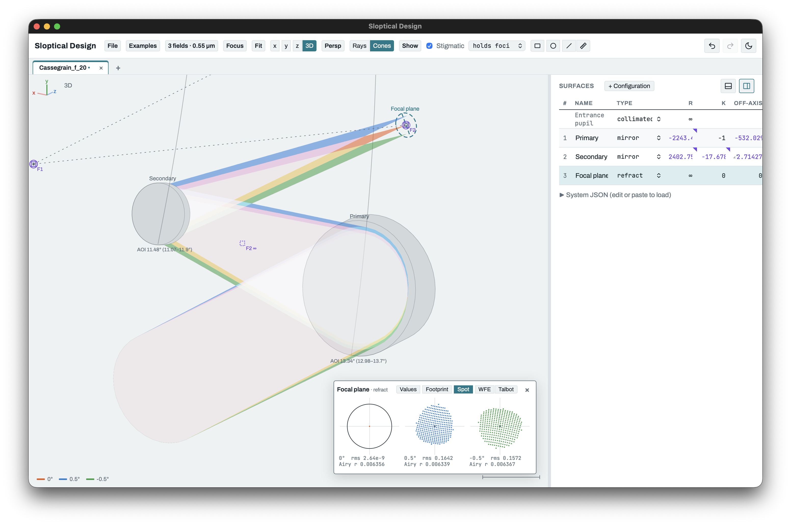

# Sloptical Design

A vibe-coded (Claude Opus 5.5), in-browser tool for sketching out simple optical systems with a sorta intuitive interface. Assume the results are wrong until you've exported them to some other, human-coded raytrace tool!

There are many bugs—use with caution.



**Try it:** https://kvangorkom.github.io/sloptical-design/

Press **H** in the app for the keys and a short guide to every feature.

## Running it

- **In a browser:** open `index.html`. Nothing to install or build.
- **Served locally:** `npm run serve` (or `python3 -m http.server`), then open http://localhost:8000. Served this way,
  the page also loads the Python scripts in `extensions/`.
- **As a desktop app:** `pip install pywebview`, then `python3 optic_app.py [design.json ...]`. This is the same page
  in a native window, where Save writes straight back to the file on disk. The page can reach only the files you
  open or save there. To package it as a double-clickable app:
  ```sh
  pyinstaller --windowed --name "Sloptical Design" --distpath app-dist --workpath app-build \
    --add-data "index.html:." --add-data "src:src" --add-data "extensions:extensions" optic_app.py
  ```
- **Driven from Python:** `python3 optic_live.py serve design.json` opens the page watching the file, so any script
  that rewrites the file updates the view. `optic_live.py` explains more.

## GitHub Pages

`.github/workflows/pages.yml` runs the tests on every push, then builds `dist/index.html` (one self-contained file)
and publishes it. To turn it on, go to **Settings ▸ Pages** and set **Source** to **GitHub Actions**. To try the build
locally, run `npm run build` and open `dist/index.html`.

## Tests

`npm test` needs Node 18 or newer. The suite cross-checks the tracer against [batoid](https://github.com/jmeyers314/batoid)
and [optiland](https://github.com/HarrisonKramer/optiland) when they are installed (`pip install batoid optiland`)
and skips those checks when they are not.
